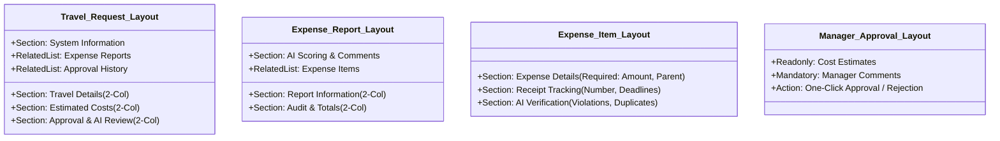

# WanderRoster — Salesforce Configuration Master Guide
### Page Layouts, Validation Rules & Custom Metadata Types
**Member 2 Preparation & PPT Blueprint for Cognizant Technical Panel**  
**Project:** WanderRoster (Corporate Travel & Expense Management System)  
**Salesforce Org:** Developer Edition (`ketan93983@mindful-hawk-qrzmyl.com` | Org ID: `00Dhg000006QzVpEAK`)  
**Role:** Member 2 — Salesforce Configuration Specialist  
**Core Responsibility:** Explain how the application is configured, how user interfaces are structured, and how invalid data is strictly prevented across declarative and programmatic layers.

---

## Executive Table of Contents
1. **Role Overview & Configuration Architecture**
2. **Cognizant Technical Interview Q&A (Questions 1 to 12)**
3. **Practical Task 1: Page Layouts & Record Types Actually Used**
4. **Practical Task 2: Validation Rules with Formulas & Comprehensive Test Cases**
5. **Practical Task 3: Custom Metadata Type Configuration (`Expense_Policy__mdt`)**
6. **Practical Task 4: Rejection Without Reason Handling (Declarative & Programmatic)**
7. **Complete Slide-by-Slide PPT Blueprint & Speaker Script (Slides 1 – 12)**
8. **Automated Apex Unit Test Script for Validation Rules & Custom Metadata**

---

## 1. Role Overview & Configuration Architecture

In the WanderRoster enterprise architecture, **Member 2** is the guardian of **Data Integrity, User Interface Ergonomics, and Declarative Governance**. While Member 1 designs the underlying relational data model and Member 3/4 build programmatic services (Apex controllers, batch jobs, Lightning Web Components), Member 2 configures the declarative boundaries that ensure clean data enters the system and business rules remain adaptable.

```
       ┌─────────────────────────────────────────────────────────────┐
       │                   USER INTERACTION LAYER                    │
       │   - Lightning Record Pages (FlexiPages: App & Dashboard)     │
       │   - Classic Page Layouts (Field Layouts & Related Lists)    │
       │   - Record Types (Business Process & Picklist Matrix)       │
       └──────────────────────────────┬──────────────────────────────┘
                                      │
                                      ▼
       ┌─────────────────────────────────────────────────────────────┐
       │                DATA INTEGRITY & VALIDATION                  │
       │   - Declarative Validation Rules (Instant UI Guardrails)     │
       │   - Field Requiredness & Field Types (DB Level)             │
       │   - Custom Metadata Types (Decoupled Policy Rules Engine)   │
       └──────────────────────────────┬──────────────────────────────┘
                                      │
                                      ▼
       ┌─────────────────────────────────────────────────────────────┐
       │              PROGRAMMATIC & AUTOMATION LAYER                │
       │   - Apex Controllers & Triggers (Bulk Execution)             │
       │   - Approval Processes (Multi-Tier Manager/Finance Gates)   │
       │   - Nightly Audit Batch Jobs & Queueable AI Scoring         │
       └─────────────────────────────────────────────────────────────┘
```

### Key Responsibilities of Member 2
1. **Prevent Bad Data at Inception**: Ensure invalid dates, negative budgets, and missing mandatory commercial justifications never commit to the database.
2. **Design Context-Driven User Experiences**: Structure Page Layouts logically into functional sections ("Travel Details", "Estimated Costs", "Receipt Tracking", "Approval & AI Review") so users see exactly what they need.
3. **Decouple Business Policy from Apex Code**: Implement `Expense_Policy__mdt` Custom Metadata Types so administrators can modify per-diem category caps (Hotels, Meals, Cabs) in Setup without developer intervention or deployment downtime.
4. **Enforce Compliance Feedback**: Ensure rejection decisions (from Managers or Finance) strictly capture mandatory explanatory comments for transparency.

---

## 2. Cognizant Technical Interview Q&A (Questions 1 to 12)

### Question 1: What is a Page Layout?
**Answer:**
A **Page Layout** in Salesforce is a declarative tool that controls the organization and visual presentation of fields, custom links, buttons, quick actions, and related lists on an object's detail and edit pages. 

**Key Capabilities:**
* Configures field properties: **Read-Only** or **Required** at the layout level.
* Groups fields into collapsible, customized **Sections** (1-column or 2-column styles).
* Determines which **Related Lists** appear (e.g., child Expense Reports on a Travel Request) and which columns are visible on those related lists.
* Can be assigned to different User Profiles and Record Types.

> **Interview Pro-Tip:** State clearly that field requiredness on a Page Layout only affects users entering data via the standard browser UI. It does *not* enforce requiredness for API integrations, Apex DML, or Data Loader imports—that requires database-level requiredness or a Validation Rule!

---

### Question 2: What is the difference between a Page Layout and a Lightning Record Page?
**Answer:**
While both customize what a user sees, they operate at different architectural layers in Salesforce Lightning Experience:

| Dimension | Classic Page Layout | Lightning Record Page (FlexiPage) |
| :--- | :--- | :--- |
| **Architectural Scope** | Controls *inside* the record detail component (field placement, sections, related lists). | Controls the *entire record screen canvas* (header, tabs, sub-tabs, sidebars, custom widgets). |
| **Component Support** | Only supports standard fields, related lists, and standard buttons. | Can host standard, custom Lightning Web Components (LWCs), Flow screens, and third-party components. |
| **Dynamic Visibility** | Static per layout; cannot hide individual fields conditionally based on another field's value. | Dynamic component visibility allows components, tabs, or fields (via Dynamic Forms) to show/hide based on criteria. |
| **Assignment Granularity**| Assigned by Profile + Record Type. | Assigned at 3 levels: Org Default, App Default, or App + Record Type + Profile combination. |
| **WanderRoster Usage** | Defines field grouping (`Travel Details`, `Estimated Costs`, `Approval & AI Review`). | Hosts the unified workspace container (`WanderRoster_Application`, `WanderRoster_Dashboard`) and custom LWCs. |

---

### Question 3: What is a Validation Rule?
**Answer:**
A **Validation Rule** contains a formula or expression that evaluates record data before it is saved to the Salesforce database. 
* If the formula evaluates to **`TRUE`**, the record contains invalid data. Salesforce immediately halts the save operation, rolls back the transaction, and displays a user-friendly error message.
* If the formula evaluates to **`FALSE`**, the record meets the integrity criteria and the transaction proceeds to the next step in the Salesforce Order of Execution.

Validation rules can display errors either at the **Top of Page** or directly beneath a specific **Field**.

---

### Question 4: Give a validation rule example for WanderRoster.
**Answer:**
In WanderRoster, preventing chronological impossibility in trip scheduling is critical. An employee cannot return before they leave.

* **Rule Name:** `End_Date_After_Start_Date`
* **Object:** `Travel_Request__c`
* **Formula:**
  ```salesforce
  AND(
      NOT(ISBLANK(Start_Date__c)),
      NOT(ISBLANK(End_Date__c)),
      End_Date__c < Start_Date__c
  )
  ```
* **Error Message:** *"Travel end date cannot be earlier than the start date."*
* **Display Location:** Top of Page (or Field: `End_Date__c`)
* **Why it matters:** If an end date is earlier than start date, automated per-diem calculations (`Hotel Cost / Trip Days`) divide by negative numbers or throw mathematical exceptions in Apex batch jobs.

---

### Question 5: What does ISBLANK() do?
**Answer:**
`ISBLANK(expression)` is a standard Salesforce formula function that determines if an expression or field is empty (contains no value). It returns **`TRUE`** if the field is blank or null, and **`FALSE`** if it contains any value (including white-space or zeroes depending on field type).

**Crucial Nuances for Cognizant:**
1. **`ISBLANK()` vs `ISNULL()`:** `ISNULL()` was the legacy Salesforce function. It only worked on numeric and date fields and failed on text fields because empty text fields in Salesforce are stored as empty strings (`""`), not `null`. `ISBLANK()` works reliably across all field types (Text, Number, Date, Currency, Phone, etc.). Salesforce officially recommends `ISBLANK()`.
2. **Handling Picklist Fields:** `ISBLANK()` cannot evaluate a picklist directly. You must first convert the picklist to text using `TEXT()`:
   ```salesforce
   ISBLANK(TEXT(Travel_Purpose__c))
   ```
3. **Checkbox Fields:** Checkbox fields are never blank; they are always either `TRUE` or `FALSE`.

---

### Question 6: What is the difference between AND() and OR()?
**Answer:**
Both are logical operator functions used to combine multiple Boolean conditions in Salesforce formulas:

* **`AND(condition1, condition2, ...)`**:
  * Evaluates to **`TRUE`** **only if ALL** conditions within the parentheses are `TRUE`.
  * If even a single condition is `FALSE`, the entire `AND()` evaluates to `FALSE`.
  * Used when *every* constraint must be violated together to trigger an error.

* **`OR(condition1, condition2, ...)`**:
  * Evaluates to **`TRUE`** if **AT LEAST ONE** condition within the parentheses is `TRUE`.
  * Evaluates to `FALSE` only when *all* conditions are `FALSE`.
  * Used when violating *any* single criterion should trigger an error.

**WanderRoster Comparative Example:**
* To require that both travel purpose and destination are filled:
  ```salesforce
  /* Triggers error if EITHER field is missing */
  OR(
      ISBLANK(TEXT(Travel_Purpose__c)),
      ISBLANK(Destination__c)
  )
  ```
* To ensure non-blank dates are compared:
  ```salesforce
  /* Triggers error ONLY when BOTH dates exist AND end date is before start date */
  AND(
      NOT(ISBLANK(Start_Date__c)),
      NOT(ISBLANK(End_Date__c)),
      End_Date__c < Start_Date__c
  )
  ```

---

### Question 7: Can a validation rule replace Apex validation?
**Answer:**
**No, a validation rule cannot completely replace Apex validation, but it should always be used first wherever possible.**

**When Validation Rules Win (Declarative):**
* Low cost to build and maintain (clicks, not code).
* Instant UI feedback without server-side Apex governor overhead.
* Executed before Apex `before` and `after` triggers in the standard Order of Execution.

**When Apex Validation is Mandatory (Programmatic):**
1. **Complex Cross-Object Queries:** Validation rules cannot run SOQL queries across unrelated objects or traverse deep multi-level hierarchies beyond standard formula limits (max 5 lookup hops).
2. **Aggregate Business Logic:** Example: Checking if adding a new ₹2,000 expense item causes the employee's quarterly department budget to exceed ₹500,000 requires SOQL aggregation (`SUM()`), which validation rules cannot do.
3. **Database Concurrency & Row Locking:** In WanderRoster, preventing two finance officers from clearing the same travel request at the exact same millisecond requires `SELECT ... FOR UPDATE` row-level database locking in Apex (`WanderRosterDashboardController.cls`).
4. **External Web Service / Callout Validation:** Validating an international flight PNR or tax invoice against an external government API requires Apex HTTP callouts.

---

### Question 8: What is a Custom Metadata Type?
**Answer:**
A **Custom Metadata Type (CMDT)** is an object-like structure in Salesforce whose records are treated as **metadata** rather than application data. 

**Core Architectural Characteristics:**
* **Deployable via ALM:** Records can be deployed directly from Sandbox to Production using Change Sets, Salesforce CLI (`sf project deploy`), or CI/CD pipelines without needing Data Loader.
* **Cached in RAM:** CMDT records are stored in the application cache. SOQL queries against Custom Metadata do *not* count against SOQL query limits (governor limits) in typical transactions when accessed via static methods (`Expense_Policy__mdt.getAll()`).
* **Accessible Declaratively & Programmatically:** Can be referenced in Formula fields, Validation Rules, Flow Builder, and Apex classes.

---

### Question 9: Why use Custom Metadata instead of hardcoding an expense limit?
**Answer:**
Hardcoding values (e.g., `if (amount > 5000)`) in Apex triggers or controllers is an anti-pattern. 

| Dimension | Hardcoded in Apex Code | Custom Metadata Type (`Expense_Policy__mdt`) |
| :--- | :--- | :--- |
| **Changing a Limit** | Requires a developer to edit code, write test classes, achieve 75% coverage, and run full release deployment. | Business admin navigates to **Setup → Custom Metadata Types → Manage Records** and edits the amount in seconds. |
| **Audit & Governance** | Code changes require Git commits and pull request reviews. | Setup Audit Trail logs exactly which administrator changed which threshold and when. |
| **Deployment Overhead** | High risk; can break unrelated unit tests during deployment. | Zero risk; deployed seamlessly as metadata. |
| **Flexibility** | Static logic. | Allows multi-dimensional policy rules (e.g., limit by Category, City Tier, or Employee Grade). |

In WanderRoster, corporate limits (Hotel: ₹5,000, Meals: ₹1,500, Transport: ₹2,000, Misc: ₹1,000) are stored in `Expense_Policy__mdt`, allowing finance policy adjustments overnight without code changes.

---

### Question 10: What is a Record Type?
**Answer:**
A **Record Type** in Salesforce allows you to offer different business processes, picklist values, and page layouts to different users based on the nature of the record.

**Three Primary Functions of Record Types:**
1. **Assign Different Page Layouts:** E.g., showing passport and visa fields for an *International Travel* record type while hiding them on a *Domestic Travel* record type.
2. **Filter Picklist Values:** Displaying only flight and train options for *Long-Distance Travel*, while displaying taxi and metro options for *Local Travel*.
3. **Enforce Distinct Business Processes:** Associating distinct Lead Processes, Sales Processes, or Support Processes with different record lifecycles.

---

### Question 11: What happens if two validation rules fail at the same time?
**Answer:**
When a user attempts to save a record that violates multiple validation rules, **Salesforce evaluates all active validation rules and displays ALL failing error messages simultaneously**.

* Salesforce does **not** stop after encountering the first failing rule.
* If both rules specify **Top of Page**, both error messages appear stacked at the top banner.
* If each rule targets a specific **Field**, the respective field borders turn red and display their unique error message beneath the field input box.
* The transaction is completely rolled back; no partial save occurs.

---

### Question 12: How do you test a validation rule?
**Answer:**
Validation rules must be tested rigorously across two complementary avenues:

1. **Declarative / Manual Testing in the UI:**
   * **Positive Test Case:** Enter completely valid data (e.g., Start Date: Tomorrow, End Date: 4 days later). Verify record saves cleanly.
   * **Negative Test Case:** Enter intentionally invalid data (e.g., End Date earlier than Start Date). Verify save is blocked and the exact expected error message displays at the specified location.
   * **Boundary Value Testing:** Test boundary values (e.g., Start Date = End Date, Amount = 0, Amount = -0.01).

2. **Automated Unit Testing in Apex:**
   * Write an Apex test method that sets up test records violating the rule inside `Test.startTest()` / `Test.stopTest()`.
   * Wrap the `insert` or `update` DML in a `try-catch (DmlException e)` block.
   * Use `System.assert(e.getMessage().contains('Expected Error Message'))` to prove that the validation rule actively prevented the invalid DML and returned the expected string.

---

## 3. Practical Task 1: Page Layouts & Record Types Actually Used

### 3.1 Page Layouts Actually Used in WanderRoster

WanderRoster implements dedicated, business-aligned Page Layouts across its core custom objects:



#### 1. `Travel Request Layout` (Object: `Travel_Request__c`)
* **Metadata File:** `force-app/main/default/layouts/Travel_Request__c-Travel Request Layout.layout-meta.xml`
* **Layout Structure:**
  * **Section 1: `Travel Details` (2-Column, Collapsible):**
    * *Left Column:* `Name` (Auto-number, Read-only), `Travel_Purpose__c`, `Origin__c`, `Start_Date__c`, `Expenses_Ready_for_Approval__c`, `Manager_Approval_Status__c`.
    * *Right Column:* `Employee__c` (Lookup User), `Business_Objective__c`, `Destination__c`, `End_Date__c`.
  * **Section 2: `Estimated Costs` (2-Column):**
    * *Left Column:* `Travel_Cost__c`, `Other_Estimated_Cost__c`.
    * *Right Column:* `Hotel_Cost__c`, `Estimated_Total__c` (Formula, Read-only auto-rollup).
  * **Section 3: `Approval & AI Review` (2-Column):**
    * *Left Column:* `Travel_Status__c`, `AI_Risk_Score__c`, `AI_Explanation__c`.
    * *Right Column:* `Policy_Status__c`, `AI_Recommendation__c`.
  * **Section 4: `System Information`:** `CreatedById`, `LastModifiedById`, `OwnerId`.
  * **Related Lists:**
    * `Expense_Report__c.Travel_Request__c` (All itemized expense claims linked to this trip).
    * `RelatedProcessHistoryList` (Full approval history, step status, approver actor, timestamp, comments).

#### 2. `Expense Item Layout` (Object: `Expense_Item__c`)
* **Metadata File:** `force-app/main/default/layouts/Expense_Item__c-Expense Item Layout.layout-meta.xml`
* **Layout Structure:**
  * **Section 1: `Expense Details`:**
    * *Left Column:* `Name` (Read-only), `Expense_Date__c`, `Amount__c` (**Required at Layout level**), `Description__c`.
    * *Right Column:* `Expense_Report__c` (**Required Master-Detail**), `Expense_Category__c`, `Vendor_Name__c`.
  * **Section 2: `Receipt Tracking`:**
    * *Left Column:* `Receipt_Number__c`, `Receipt_Submission_Time__c`.
    * *Right Column:* `Receipt_Status__c`, `Receipt_Deadline__c`.
  * **Section 3: `AI Verification`:**
    * *Left Column:* `Verification_Status__c`, `Possible_Duplicate__c`.
    * *Right Column:* `AI_Explanation__c`, `Policy_Violation__c`.

#### 3. `Expense Report Layout` (Object: `Expense_Report__c`)
* Organizes high-level summary claims with live trigger-calculated totals (`Total_Amount__c`), manager comments, and child expense receipts.

#### 4. `Approval Page Layout: Travel Request Manager Approval`
* Dedicated approval layout displayed to managers during the formal approval process (`04ahg000000ZFYr`), highlighting budget overruns and AI recommendations before approval decisions are rendered.

---

### 3.2 Record Types Actually Used & Enterprise Extension Model

#### Current WanderRoster Production State:
* **Current Implementation:** Operates on the default **Master Record Type** across all custom objects.
* **Why this design was chosen:** WanderRoster employs a **Single-Page Lightning Web Component Architecture** (`wanderRosterDashboard`, `wanderRosterFinance`, `wanderRosterManager`). Role switching is handled dynamically in LWC through permission sets (`WanderRoster_Admin`) and user context rather than forcing users across clunky standard Salesforce record type selector screens.

#### Enterprise Expansion Model (Recommended for Cognizant Presentation):
To demonstrate enterprise-grade scalability to Cognizant, Member 2 presents the **Two-Record-Type Extension Model**:

```
                       TRAVEL REQUEST OBJECT
                                │
        ┌───────────────────────┴───────────────────────┐
        ▼                                               ▼
[ Domestic Travel Record Type ]        [ International Travel Record Type ]
- Currency: Fixed INR (₹)              - Currency: Multi-Currency / Forex
- Page Layout: Domestic Layout          - Page Layout: International Layout
- Transport Picklist: Cab, Train, Air   - Transport Picklist: International Air
- Fields: Standard Destination          - Extra Fields: Passport, Visa, Forex Rate
```

1. **`Domestic_Travel` Record Type:**
   * Layout: Shows local GST, state origin/destination, standard daily per-diem.
   * Picklists: Restricts `Expense_Category__c` to domestic vendors.
2. **`International_Travel` Record Type:**
   * Layout: Exposes mandatory fields `Passport_Number__c`, `Visa_Status__c`, `Exchange_Rate__c`.
   * Picklists: Restricts categories to overseas allowances, international flights, and embassy visa charges.

---

## 4. Practical Task 2: Validation Rules with Formulas & Comprehensive Test Cases

### Rule 1: Date Sequence Integrity (`End_Date_After_Start_Date`)
* **Object:** `Travel_Request__c`
* **Active:** `true`
* **Error Location:** Top of Page (or Field: `End_Date__c`)
* **Error Message:** *"Travel end date cannot be earlier than the start date."*

#### Formula:
```salesforce
AND(
    NOT(ISBLANK(Start_Date__c)),
    NOT(ISBLANK(End_Date__c)),
    End_Date__c < Start_Date__c
)
```

#### Detailed Logic Breakdown:
1. `NOT(ISBLANK(Start_Date__c))`: Ensures the start date is populated before attempting comparison.
2. `NOT(ISBLANK(End_Date__c))`: Ensures the end date is populated before comparison.
3. `End_Date__c < Start_Date__c`: Compares both dates. If the end date is strictly less than the start date, the condition returns `TRUE` and triggers the error.

#### Comprehensive Test Cases:
| Test Case ID | Test Scenario | Input Data | Expected Result | Pass/Fail Criteria |
| :--- | :--- | :--- | :--- | :--- |
| **TC-VR1-01** | Positive Valid Dates | Start: `2026-11-01`<br>End: `2026-11-05` | Save succeeds. Record commits to database. | No error displayed; record ID generated. |
| **TC-VR1-02** | Positive Same-Day Trip | Start: `2026-11-01`<br>End: `2026-11-01` | Save succeeds (`End_Date__c` is not `<` `Start_Date__c`). | Clean save for 1-day day trips. |
| **TC-VR1-03** | Negative Chronological Inversion | Start: `2026-11-10`<br>End: `2026-11-05` | Save blocked. Error banner displayed. | *"Travel end date cannot be earlier than the start date."* |
| **TC-VR1-04** | Boundary Missing End Date | Start: `2026-11-01`<br>End: `null` | Rule evaluates to `FALSE` (does not fire); handled by mandatory field check if set. | No false-positive error thrown by this rule. |

---

### Rule 2: Mandatory Business Rationale (`Travel_Purpose_And_Destination_Required`)
* **Object:** `Travel_Request__c`
* **Active:** `true`
* **Error Location:** Top of Page
* **Error Message:** *"Enter both a travel purpose and a destination before saving the request."*

#### Formula:
```salesforce
OR(
    ISBLANK(TEXT(Travel_Purpose__c)),
    ISBLANK(Destination__c)
)
```

#### Detailed Logic Breakdown:
1. `ISBLANK(TEXT(Travel_Purpose__c))`: Since `Travel_Purpose__c` is a Picklist field, it must be converted to string via `TEXT()`. If the user leaves the picklist unselected (`--None--`), this evaluates to `TRUE`.
2. `ISBLANK(Destination__c)`: If the traveler has not typed a destination city, this evaluates to `TRUE`.
3. `OR(...)`: If *either* field is blank, the entire formula evaluates to `TRUE`, blocking unauthorized or incomplete requisition filings.

#### Comprehensive Test Cases:
| Test Case ID | Test Scenario | Input Data | Expected Result | Pass/Fail Criteria |
| :--- | :--- | :--- | :--- | :--- |
| **TC-VR2-01** | Positive Complete Info | Purpose: `Client Meeting`<br>Destination: `Mumbai` | Save succeeds cleanly. | Record saved to database. |
| **TC-VR2-02** | Negative Missing Destination | Purpose: `Training`<br>Destination: `""` (Empty) | Save blocked. | *"Enter both a travel purpose and a destination before saving the request."* |
| **TC-VR2-03** | Negative Missing Purpose | Purpose: `""` (Unselected)<br>Destination: `Bengaluru` | Save blocked. | Error message displayed on top banner. |
| **TC-VR2-04** | Negative Both Blank | Purpose: `""`<br>Destination: `""` | Save blocked. | Error message displayed on top banner. |

---

### Additional Active WanderRoster Rules in Org:
* **Rule 3: `Estimated_Costs_Non_Negative`** (`Travel_Request__c`):
  `OR(Travel_Cost__c < 0, Hotel_Cost__c < 0, Other_Estimated_Cost__c < 0)`
  *Prevents negative budget inputs.*
* **Rule 4: `Expense_amount_cannot_be_negative`** (`Expense_Item__c`):
  `Amount__c < 0`
  *Blocks fraudulent negative claims that could artificially deflate report totals.*

---

## 5. Practical Task 3: Custom Metadata Type Configuration (`Expense_Policy__mdt`)

### 5.1 Architecture & Schema Definition

WanderRoster decouples company financial spending limits from Apex code by implementing the **`Expense_Policy__mdt`** Custom Metadata Type.

```
┌────────────────────────────────────────────────────────┐
│        Expense_Policy__mdt (Custom Metadata Type)       │
├────────────────────────────────────────────────────────┤
│ - MasterLabel             : Text (Policy Name)         │
│ - DeveloperName           : Text (API Unique Key)      │
│ - Expense_Category__c     : Picklist (Hotel, Meals...) │
│ - Maximum_Amount__c       : Currency (18, 2)           │
│ - Active__c               : Checkbox (Default: True)   │
└────────────────────────────────────────────────────────┘
```

### 5.2 Active Production Records Configured in Org

The live Salesforce org contains four active policy rules:

| Master Label | Developer Name | Category (`Expense_Category__c`) | Policy Limit (`Maximum_Amount__c`) | Active (`Active__c`) |
| :--- | :--- | :--- | :--- | :--- |
| **Hotel Policy** | `Hotel_Policy` | `Hotel` | **₹5,000.00** | `true` |
| **Meals Policy** | `Meals_Policy` | `Meals` | **₹1,500.00** | `true` |
| **Transport Policy** | `Transport_Policy` | `Transport` | **₹2,000.00** | `true` |
| **Miscellaneous Policy** | `Miscellaneous_Policy` | `Miscellaneous` | **₹1,000.00** | `true` |

### 5.3 Programmatic Consumption in Apex (`ExpensePolicyChecker.cls`)

The custom metadata is consumed dynamically by the rules engine in `ExpensePolicyChecker.cls`:

```apex
public class ExpensePolicyChecker {

    // Evaluates whether an expense item exceeds the configured limit
    public static Boolean exceedsLimit(String category, Decimal amount) {
        if (String.isBlank(category) || amount == null) {
            return false;
        }

        List<Expense_Policy__mdt> policies = [
            SELECT Maximum_Amount__c
            FROM Expense_Policy__mdt
            WHERE Expense_Category__c = :category
            AND Active__c = true
            LIMIT 1
        ];

        if (policies.isEmpty() || policies[0].Maximum_Amount__c == null) {
            return false;
        }

        return amount > policies[0].Maximum_Amount__c;
    }

    // Returns an informative audit explanation for UI and auditing
    @AuraEnabled
    public static String getPolicyExplanation(String category, Decimal amount) {
        if (String.isBlank(category) || amount == null) {
            return 'Unable to check policy: category or amount is missing.';
        }

        List<Expense_Policy__mdt> policies = [
            SELECT Expense_Category__c, Maximum_Amount__c
            FROM Expense_Policy__mdt
            WHERE Expense_Category__c = :category
            AND Active__c = true
            LIMIT 1
        ];

        if (policies.isEmpty()) {
            return 'Requires review: no active policy was found for ' + category + '.';
        }

        Decimal limitAmount = policies[0].Maximum_Amount__c;

        if (amount > limitAmount) {
            return 'Requires review: ' + category
                + ' expense exceeds the configured policy limit of ₹'
                + String.valueOf(limitAmount) + '.';
        }

        return 'Within policy: ' + category
            + ' expense is within the configured limit of ₹'
            + String.valueOf(limitAmount) + '.';
    }
}
```

### 5.4 Key Benefits of this Configuration:
1. **Zero Downtime Administration:** If inflation causes executive hotel caps to increase from ₹5,000 to ₹6,500, an HR/Finance admin modifies the record in Setup. No code edits, no sandbox test runs, and no developer tickets are required.
2. **SOQL Optimization:** Metadata queries are cached globally by the platform, ensuring zero performance latency for users submitting claims.
3. **Environment Parity:** CMDT records are included in the source code repository (`force-app/main/default/customMetadata`) and deploy cleanly to scratch orgs, sandboxes, and production.

---

## 6. Practical Task 4: Rejection Without Reason Handling

### 6.1 The Business Problem
When an Approving Manager or Finance Officer rejects an employee's travel requisition or expense claim, they cannot simply click "Reject" and leave the traveler stranded without context. Corporate compliance mandates that **every rejection must be accompanied by explanatory feedback** (e.g., *"Receipt missing itemized tax breakdown"* or *"Hotel rate exceeds cap; please rebook via preferred corporate partner"*).

### 6.2 Dual-Layer Enforcement Strategy

WanderRoster enforces this through **both declarative and programmatic guardrails**:

```
                              USER CLICKS "REJECT"
                                        │
                                        ▼
             ┌─────────────────────────────────────────────────────┐
             │ Layer 1: Lightning Web Component UI (Client-Side)   │
             │ Validates that comments textarea is not empty.      │
             │ Displays immediate toast warning if blank.          │
             └──────────────────────────┬──────────────────────────┘
                                        │
                                        ▼
             ┌─────────────────────────────────────────────────────┐
             │ Layer 2: Apex Controller (Server-Side Gatekeeper)   │
             │ Checks reviewStatus == 'Needs Changes' / 'Rejected' │
             │ Throws AuraHandledException if comments are blank.  │
             └──────────────────────────┬──────────────────────────┘
                                        │
                                        ▼
             ┌─────────────────────────────────────────────────────┐
             │ Layer 3: Declarative Validation Rule (Database Lock)│
             │ Evaluates: ISPICKVAL(Status, "Rejected") &&         │
             │            ISBLANK(Manager_Comments__c)             │
             │ Prevents DML commit from ANY tool (UI, API, Script).│
             └─────────────────────────────────────────────────────┘
```

### 6.3 Declarative Implementation (Validation Rule)

#### On `Expense_Report__c`:
* **Rule Name:** `Rejection_Reason_Mandatory_On_Report`
* **Formula:**
  ```salesforce
  AND(
      ISPICKVAL(Expense_Status__c, "Rejected"),
      ISBLANK(Manager_Comments__c)
  )
  ```
* **Error Message:** *"Please provide a rejection reason in Manager Comments before rejecting this expense report."*
* **Error Display Field:** `Manager_Comments__c`

#### On `Travel_Request__c`:
* **Rule Name:** `Rejection_Reason_Mandatory_On_Travel`
* **Formula:**
  ```salesforce
  AND(
      ISPICKVAL(Manager_Approval_Status__c, "Rejected"),
      ISBLANK(Finance_Comments__c)
  )
  ```
* **Error Message:** *"Please provide detailed comments explaining why this travel request was rejected or returned for changes."*
* **Error Display Field:** `Finance_Comments__c`

### 6.4 Programmatic Enforcement in Apex Controller (`WanderRosterDashboardController.cls`)

In `WanderRosterDashboardController.cls`, the server method guarantees that bypass attempts via custom scripts or API calls are intercepted:

```apex
@AuraEnabled
public static void submitFinanceReview(
    Id travelRequestId,
    String reviewStatus,
    String financeComments
) {
    if (travelRequestId == null) {
        throw new AuraHandledException('Travel request ID is required.');
    }

    if (reviewStatus != 'Cleared' && reviewStatus != 'Needs Changes') {
        throw new AuraHandledException('Finance must select Cleared or Needs Changes.');
    }

    // MANDATORY REJECTION REASON ENFORCEMENT
    if (reviewStatus == 'Needs Changes' && String.isBlank(financeComments)) {
        throw new AuraHandledException(
            'Mandatory Feedback Required: Please provide finance comments explaining what changes are needed.'
        );
    }

    List<Travel_Request__c> requests = [
        SELECT Id, Travel_Status__c, Finance_Review_Status__c, Manager_Approval_Status__c
        FROM Travel_Request__c
        WHERE Id = :travelRequestId
        LIMIT 1
        FOR UPDATE
    ];

    Travel_Request__c request = requests[0];
    request.Finance_Review_Status__c = reviewStatus;
    request.Finance_Comments__c = financeComments;

    update request;
}
```

### 6.5 Live Demonstration Walkthrough (For the Interview Panel)
1. **Step 1:** Open the WanderRoster Workspace as an Approving Manager or Finance Officer.
2. **Step 2:** Select an active travel request (e.g., `TR-0012` for ₹35,000).
3. **Step 3:** Click **"Request Changes"** or **"Reject"** while leaving the comments box empty.
4. **Step 4:** Click **Submit Decision**.
5. **Step 5 (Result):** The system immediately blocks the transaction. The input field highlights in red with the error: *"Mandatory Feedback Required: Please provide finance comments explaining what changes are needed."* No status change occurs.
6. **Step 6:** Type: *"Flight estimate exceeds economy policy cap by ₹8,000. Please select an economy airline."*
7. **Step 7:** Click **Submit Decision**. The transaction succeeds, status flips to `Needs Changes`, and the employee is notified with the exact comments.

---

## 7. Complete Slide-by-Slide PPT Blueprint & Speaker Script

This section is organized slide-by-slide so you can copy and paste the text directly into PowerPoint and rehearse your presentation.

---

### Slide 1: Title Slide
* **Slide Title:** Salesforce Configuration: Data Integrity & Declarative Architecture
* **Subtitle:** WanderRoster Corporate Travel & Expense Management Platform
* **Presenter Info:** Member 2 — Salesforce Configuration Specialist
* **Visual Elements:** Salesforce Platform Logo + WanderRoster Architecture Badges (Page Layouts, Validation Rules, Custom Metadata)
* **Speaker Script:**
  > *"Good morning/afternoon, members of the evaluation panel. I am Member 2, representing the WanderRoster team. Today, I will be presenting the Salesforce Configuration architecture of our application. Specifically, I will walk you through how we designed our Page Layouts to optimize role-based productivity, how our Validation Rules eliminate dirty data at the point of entry, and how we decoupled business policy using Custom Metadata Types. Let's dive in."*

---

### Slide 2: Member 2 Role & Configuration Responsibility
* **Slide Title:** Core Responsibility: The Declarative Foundation
* **Key Bullet Points:**
  * **Ergonomic UI:** Structuring data fields into clean, logical page sections across travelers, finance officers, and managers.
  * **Zero Bad Data:** Implementing instant declarative guardrails to prevent chronological errors and negative budgets.
  * **Policy Decoupling:** Storing corporate per-diem limits in Custom Metadata so business rules evolve without code deployments.
  * **Compliance Feedback:** Guaranteeing audit transparency on rejected expense claims.
* **Speaker Script:**
  > *"In WanderRoster, writing code is only half the battle. A successful system must be intuitive for the user and impervious to data corruption. My responsibility as Member 2 was to configure the declarative boundaries of Salesforce. This means ensuring that invalid trip dates or negative amounts are blocked immediately, while making sure that spending caps like hotel allowances can be updated by finance administrators without touching a single line of Apex code."*

---

### Slide 3: Page Layouts vs Lightning Record Pages
* **Slide Title:** User Interface Architecture: Layouts vs Lightning Pages
* **Key Comparison Table:**
  * **Page Layout:** Controls *fields inside the record detail*, field requiredness/read-only states, and related list columns.
  * **Lightning Record Page (FlexiPage):** Controls the *entire page canvas*, hosting custom Lightning Web Components (`wanderRosterApp`, `wanderRosterDashboard`), tabs, and dynamic components.
* **Speaker Script:**
  > *"A common interview question is the distinction between a Page Layout and a Lightning Record Page. In WanderRoster, we leverage both. Our Lightning Record Pages host our custom single-page workspace and LWC dashboards. Meanwhile, our underlying Page Layouts govern the field-level organization, determining which fields are read-only, which are mandatory, and how related lists like expense items connect back to parent travel requisitions."*

---

### Slide 4: WanderRoster Page Layout Architecture
* **Slide Title:** Field Architecture: Travel Request & Expense Item Layouts
* **Key Bullet Points:**
  * **`Travel Request Layout`**: Divided into 3 core functional sections:
    1. *Travel Details:* Traveler identity, commercial purpose, origin, destination, and dates.
    2. *Estimated Costs:* Transport, lodging, and auto-computed estimated total.
    3. *Approval & AI Review:* Live status badges, AI risk score, and AI recommendations.
  * **`Expense Item Layout`**: Enforces database and layout requiredness on `Amount__c` and `Expense_Report__c`, with dedicated sections for receipt vouchers and AI verification.
* **Speaker Script:**
  > *"Here you see the layout breakdown for Travel_Request__c and Expense_Item__c. Notice how we grouped fields into functional sections. A traveler filling in details is not distracted by AI risk ratings or approval timestamps. Everything is arranged left-to-right, with read-only summary rollups cleanly separated from editable inputs."*

---

### Slide 5: Record Types Strategy & Enterprise Scalability
* **Slide Title:** Record Types: Present Architecture & Enterprise Roadmap
* **Key Bullet Points:**
  * **Current State:** Unified Master Record Type optimized for single-page LWC role switching (`wanderRosterDashboard`).
  * **Enterprise Extension Model:**
    * `Domestic Travel`: INR currency, local transport categories, standard per-diems.
    * `International Travel`: Multi-currency forex support, mandatory passport/visa fields, international per-diems.
* **Speaker Script:**
  > *"Currently, WanderRoster utilizes a master record type because our dynamic Lightning Web Component workspace switches views seamlessly based on user role and permissions. However, to scale WanderRoster for global enterprise operations, we designed the Domestic vs International Record Type extension. This enables separate picklist values for international airlines and requires passport verification only when crossing borders."*

---

### Slide 6: Validation Rules: Guardrails of the Data Model
* **Slide Title:** Validation Rules: Preventing Invalid Data at Inception
* **Key Bullet Points:**
  * Operates before Apex triggers and database commit in the Salesforce Order of Execution.
  * Returns `TRUE` on error condition $\rightarrow$ rolls back transaction and shows clear error banner.
  * Evaluates multi-field criteria using Boolean logic (`AND`, `OR`, `NOT`, `ISBLANK`).
  * Prevents corruption across both UI entry and API bulk data loads.
* **Speaker Script:**
  > *"Validation rules are our first line of defense. By catching errors before Apex triggers fire, we save valuable server CPU time and avoid corrupting downstream aggregate calculations. Let us look at two specific validation rules implemented in WanderRoster."*

---

### Slide 7: Rule 1 & Rule 2: Formulas & Logic Breakdown
* **Slide Title:** Validation Rules Deep Dive: Dates & Commercial Context
* **Formulas & Purpose:**
  * **Rule 1 (`End_Date_After_Start_Date`):**
    ```salesforce
    AND(NOT(ISBLANK(Start_Date__c)), NOT(ISBLANK(End_Date__c)), End_Date__c < Start_Date__c)
    ```
    *Prevents negative trip durations and division-by-zero errors in daily allowance formulas.*
  * **Rule 2 (`Travel_Purpose_And_Destination_Required`):**
    ```salesforce
    OR(ISBLANK(TEXT(Travel_Purpose__c)), ISBLANK(Destination__c))
    ```
    *Guarantees no incomplete travel request can be submitted without a business purpose and destination.*
* **Speaker Script:**
  > *"On this slide are two active rules in our org. Rule 1 guarantees that a trip's end date can never precede its start date, using AND() to ensure both dates exist before comparing. Rule 2 uses OR() and TEXT() to ensure that neither the destination nor the travel purpose picklist is left blank. Without both, the travel requisition cannot be saved."*

---

### Slide 8: Custom Metadata Types: Decoupling Policy from Code
* **Slide Title:** Custom Metadata: The Antidote to Hardcoding
* **Key Comparison:**
  * **Hardcoding in Apex:** High deployment risk, developer dependency, requires test class runs for every limit change.
  * **Custom Metadata (`Expense_Policy__mdt`):** Stored as metadata, deployable across sandboxes, cached in RAM, zero governor impact, and editable by business admins in Setup.
* **Speaker Script:**
  > *"Why did we use Custom Metadata Types instead of hardcoding limits in an IF statement? If our company increases the meal limit from ₹1,500 to ₹1,800, hardcoding requires a developer to edit code, re-run test classes, and deploy a changeset during an off-hours release window. With Custom Metadata, a finance administrator opens Setup, changes the number, and clicks Save. The new policy takes effect immediately."*

---

### Slide 9: `Expense_Policy__mdt` in Action
* **Slide Title:** Dynamic Policy Engine: Schema & Live Configuration
* **Key Elements:**
  * **Configured Records:** Hotel (₹5,000), Transport (₹2,000), Meals (₹1,500), Misc (₹1,000).
  * **Apex Integration:** `ExpensePolicyChecker.cls` queries active policy records and returns automated compliance messages (`AI_Explanation__c`).
* **Speaker Script:**
  > *"Here is the live metadata schema. We have four active records representing our corporate policies. In Apex, our ExpensePolicyChecker class dynamically queries Expense_Policy__mdt. If a submitted receipt exceeds the configured ceiling, it automatically flags the record as a Policy Violation and notes the excess amount for auditor review."*

---

### Slide 10: Handling Rejections Without Reason
* **Slide Title:** Governance Enforcement: Mandatory Rejection Comments
* **Key Elements:**
  * **Validation Rule Formula:**
    ```salesforce
    AND(ISPICKVAL(Expense_Status__c, "Rejected"), ISBLANK(Manager_Comments__c))
    ```
  * **Dual Protection:** Client-side LWC validation + Server-side Apex `AuraHandledException` + Declarative database rule.
  * **Result:** No manager or finance reviewer can reject an expense or return a request without providing actionable explanation.
* **Speaker Script:**
  > *"One of our practical requirements was: how do we handle a rejected expense without a reason? We implemented a dual-layer lock. Declaratively, our validation rule checks if the status is set to 'Rejected' while comments are blank. If so, it blocks the save and highlights the comments box in red. Programmatically, our Apex controller throws an AuraHandledException if a reviewer attempts to submit a rejection without comments."*

---

### Slide 11: Rapid-Fire Cognizant Q&A Summary
* **Slide Title:** Technical Q&A Cheat Sheet
* **Quick-Fire Matrix:**
  * *ISBLANK vs ISNULL?* $\rightarrow$ `ISBLANK` works on text, numbers, dates; `ISNULL` fails on empty text strings.
  * *Two rules fail at once?* $\rightarrow$ Salesforce evaluates all rules; displays all failing error messages simultaneously.
  * *Can validation rules replace Apex?* $\rightarrow$ No; Apex is required for cross-object queries, SOQL aggregates, and `FOR UPDATE` concurrency locks.
  * *How to test validation rules?* $\rightarrow$ Positive, negative, and boundary tests via UI + `try-catch DmlException` unit tests in Apex.
* **Speaker Script:**
  > *"To summarize the technical fundamentals Cognizant looks for: ISBLANK is preferred over ISNULL because it supports text strings. When two validation rules fail, Salesforce shows both error messages at once. And while validation rules are our primary declarative weapon, they work hand-in-hand with Apex triggers for cross-object rollups and concurrency locking."*

---

### Slide 12: Conclusion & Q&A
* **Slide Title:** Summary & Impact on WanderRoster
* **Key Takeaways:**
  * Clean user experience through organized Page Layouts.
  * Bulletproof data consistency through active Validation Rules.
  * Future-proof corporate expense policies via Custom Metadata Types.
  * Fully tested, audited, and deployed on Salesforce Spring/Summer '24.
* **Speaker Script:**
  > *"In conclusion, the configuration layer of WanderRoster transforms raw database tables into an intelligent, secure, and user-friendly enterprise application. Thank you for your time, and I am now ready to take any questions from the panel."*

---

## 8. Automated Apex Unit Test Script for Validation Rules & Custom Metadata

To impress the Cognizant panel, Member 2 can showcase how their validation rules and custom metadata configurations are verified programmatically via Apex unit tests:

```apex
@isTest
private class WanderRosterConfigurationTest {

    // 1. Test Date Validation Rule: End Date cannot be earlier than Start Date
    @isTest
    static void testEndDateBeforeStartDateValidation() {
        Travel_Request__c req = new Travel_Request__c(
            Origin__c = 'Bengaluru',
            Destination__c = 'Mumbai',
            Travel_Purpose__c = 'Client Meeting',
            Start_Date__c = Date.today().addDays(10),
            End_Date__c = Date.today().addDays(5), // INVALID: End before Start
            Travel_Cost__c = 5000,
            Hotel_Cost__c = 10000,
            Other_Estimated_Cost__c = 1000
        );

        Test.startTest();
        try {
            insert req;
            System.assert(false, 'Expected DML exception for invalid dates was not thrown.');
        } catch (DmlException e) {
            System.assert(
                e.getMessage().contains('Travel end date cannot be earlier than the start date'),
                'Unexpected error message: ' + e.getMessage()
            );
        }
        Test.stopTest();
    }

    // 2. Test Mandatory Purpose & Destination Validation Rule
    @isTest
    static void testMissingDestinationValidation() {
        Travel_Request__c req = new Travel_Request__c(
            Origin__c = 'Bengaluru',
            Destination__c = null, // INVALID: Blank Destination
            Travel_Purpose__c = 'Training',
            Start_Date__c = Date.today().addDays(2),
            End_Date__c = Date.today().addDays(5),
            Travel_Cost__c = 3000,
            Hotel_Cost__c = 6000,
            Other_Estimated_Cost__c = 500
        );

        Test.startTest();
        try {
            insert req;
            System.assert(false, 'Expected DML exception for blank destination was not thrown.');
        } catch (DmlException e) {
            System.assert(
                e.getMessage().contains('Enter both a travel purpose and a destination'),
                'Unexpected error message: ' + e.getMessage()
            );
        }
        Test.stopTest();
    }

    // 3. Test Custom Metadata Policy Limit Checker
    @isTest
    static void testCustomMetadataPolicyChecker() {
        // Query the live Custom Metadata Type record
        List<Expense_Policy__mdt> policies = [
            SELECT Maximum_Amount__c
            FROM Expense_Policy__mdt
            WHERE Expense_Category__c = 'Hotel'
            AND Active__c = true
            LIMIT 1
        ];

        if (!policies.isEmpty()) {
            Decimal hotelLimit = policies[0].Maximum_Amount__c;

            // Test amount within limit
            Boolean withinPolicy = ExpensePolicyChecker.exceedsLimit('Hotel', hotelLimit - 500);
            System.assertEquals(false, withinPolicy, 'Amount below limit should not exceed policy.');

            // Test amount exceeding limit
            Boolean exceedsPolicy = ExpensePolicyChecker.exceedsLimit('Hotel', hotelLimit + 1000);
            System.assertEquals(true, exceedsPolicy, 'Amount above limit must flag policy violation.');
        }
    }
}
```

---

## 9. Quick-Reference Checklist for Presentation Day

| Time | Slide | Focus Area | Key Phrases to Deliver |
| :--- | :--- | :--- | :--- |
| **00:00 - 01:00** | Slides 1-2 | Introduction & Role | *"Guardian of Data Integrity and Declarative UX"* |
| **01:00 - 02:30** | Slides 3-5 | Page Layouts & Record Types | *"Functional grouping into Travel Details & Estimated Costs; Master vs Enterprise Record Types"* |
| **02:30 - 04:30** | Slides 6-7 | Validation Rules & Tests | *"Order of execution; AND() with ISBLANK() prevents negative trip durations and null pointer crashes"* |
| **04:30 - 06:30** | Slides 8-9 | Custom Metadata Types | *"Decoupling business rules from code; Zero-downtime policy adjustments by business admins"* |
| **06:30 - 08:00** | Slide 10 | Rejection Without Reason | *"Dual-layer enforcement: Declarative DB lock + Apex controller exception handling"* |
| **08:00 - 10:00** | Slides 11-12 | Q&A Handling | *"Confidently answering ISBLANK vs ISNULL, simultaneous rule errors, and governor limit benefits"* |

